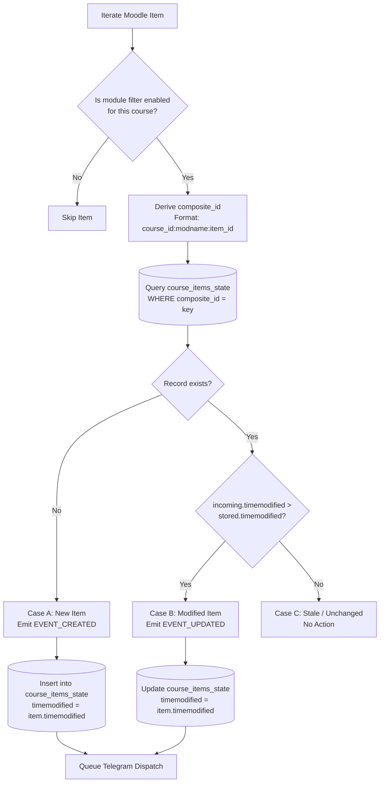
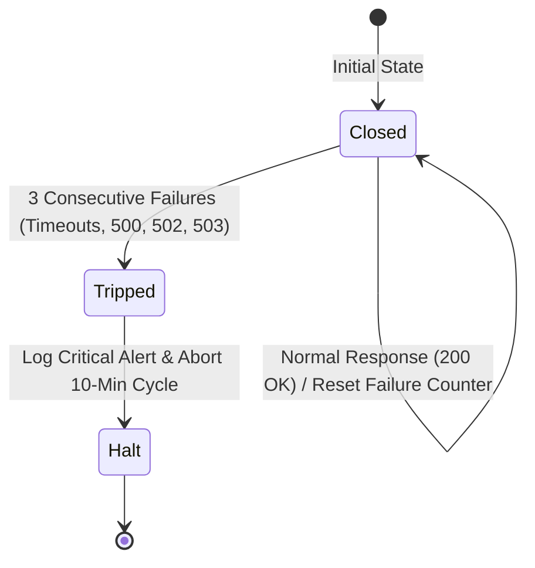

# Moodle Integration Specification: Moodle Radar

**Document Reference:** `specs/02-moodle-integration-spec.md`  
**Related Documents:** 
- [`intent/PRD.md`](file:///f:/SHADI/2-Programming/Model%20Notifications/moodle-radar/intent/PRD.md)
- [`specs/01-database-spec.md`](file:///f:/SHADI/2-Programming/Model%20Notifications/moodle-radar/specs/01-database-spec.md)
- [`specs/03-edge-functions-spec.md`](file:///f:/SHADI/2-Programming/Model%20Notifications/moodle-radar/specs/03-edge-functions-spec.md)
- [`specs/04-telegram-bot-spec.md`](file:///f:/SHADI/2-Programming/Model%20Notifications/moodle-radar/specs/04-telegram-bot-spec.md)
- [`specs/05-dashboard-frontend-spec.md`](file:///f:/SHADI/2-Programming/Model%20Notifications/moodle-radar/specs/05-dashboard-frontend-spec.md)

---

## 1. Overview & Architectural Role

The Moodle Integration layer interfaces with the university's Moodle instance using its built-in **Mobile Web Services REST API**. It handles token validation, course discovery, and periodic delta polling to detect updates without causing university firewall triggers or excessive server load.

### Key Operational Constants
- **REST Gateway URL:** `{moodle_base_url}/webservice/rest/server.php`
- **Response Format:** `moodlewsrestformat=json`
- **Polling Cadence:** Every 10 minutes (triggered via `pg_cron`)
- **Spoofed Client Identity:** `MoodleMobile/4.4.0 (Android; SDK 34; wv) Mobile`

---

## 2. Moodle REST API Contracts

### 2.1 Function: `core_webservice_get_site_info`
* **Purpose:** Validates the donor's token, retrieves user identity, verifies site compatibility, and checks mobile service permissions.
* **HTTP Method:** `POST` or `GET`
* **Query/Body Parameters:**
  ```text
  wstoken: <DECRYPTED_TOKEN>
  wsfunction: core_webservice_get_site_info
  moodlewsrestformat: json
  ```
* **Success Response Schema (200 OK):**
  ```json
  {
    "sitename": "University E-Learning Portal",
    "username": "202100452",
    "firstname": "Ahmad",
    "lastname": "Al-Mansoor",
    "fullname": "Ahmad Al-Mansoor",
    "lang": "en",
    "userid": 8412,
    "siteurl": "https://moodle.university.edu",
    "userpictureurl": "https://moodle.university.edu/pluginfile.php/...",
    "functions": [
      { "name": "core_course_get_contents", "version": "2022112800" },
      { "name": "mod_forum_get_forum_discussions", "version": "2022112800" }
    ],
    "userissiteadmin": false
  }
  ```
* **Validation Acceptance Criteria:**
  - `userid` must be present and a positive integer.
  - If the response contains an `exception` field (e.g., `invalidtoken`, `accessexception`), the handshake is rejected with an explicit error message.

---

### 2.2 Function: `core_enrol_get_users_courses`
* **Purpose:** Discovers all courses in which the donor student is officially enrolled.
* **Query/Body Parameters:**
  ```text
  wstoken: <DECRYPTED_TOKEN>
  wsfunction: core_enrol_get_users_courses
  userid: <DONOR_MOODLE_USER_ID>
  moodlewsrestformat: json
  ```
* **Success Response Schema (200 OK):**
  ```json
  [
    {
      "id": 1042,
      "shortname": "SEC301",
      "fullname": "Network Security & Cryptography",
      "displayname": "Network Security & Cryptography (Sec 1)",
      "category": 14,
      "summary": "Introduction to applied cryptography and protocol analysis.",
      "startdate": 1708819200,
      "enddate": 1718064000,
      "visible": 1
    },
    {
      "id": 1045,
      "shortname": "CS204",
      "fullname": "Database Management Systems",
      "category": 12,
      "visible": 1
    }
  ]
  ```
* **Processing Rules:**
  - Courses with `visible == 0` are excluded from the auto-discovery preview.
  - `id`, `fullname`, and `shortname` are mapped to the `courses` table.

---

### 2.3 Function: `core_course_get_contents`
* **Purpose:** Fetches the complete module hierarchy of a single course, including sections, uploaded files (`mod_resource`), external links (`mod_url`), and assignments (`mod_assign`).
* **Query/Body Parameters:**
  ```text
  wstoken: <DECRYPTED_TOKEN>
  wsfunction: core_course_get_contents
  courseid: <MOODLE_COURSE_ID>
  moodlewsrestformat: json
  ```
* **Extracted Module Structure:**
  ```json
  [
    {
      "id": 4012,
      "name": "Week 3: Public Key Cryptography",
      "visible": 1,
      "modules": [
        {
          "id": 9814,
          "name": "Lecture 05 - RSA Algorithm Slides.pdf",
          "modname": "resource",
          "url": "https://moodle.university.edu/mod/resource/view.php?id=9814",
          "dates": [
            { "label": "Modified", "timestamp": 1713342000 }
          ],
          "contents": [
            {
              "type": "file",
              "filename": "Lecture_05_RSA.pdf",
              "filesize": 2451000,
              "fileurl": "https://moodle.university.edu/webservice/pluginfile.php/...",
              "timemodified": 1713342000
            }
          ]
        },
        {
          "id": 9820,
          "name": "Lab Assignment 2: OpenSSL Implementation",
          "modname": "assign",
          "url": "https://moodle.university.edu/mod/assign/view.php?id=9820",
          "dates": [
            { "label": "Due", "timestamp": 1713999600 }
          ],
          "contentsinfo": {
            "filescount": 1,
            "filessize": 154000
          }
        }
      ]
    }
  ]
  ```

---

### 2.4 Function: `mod_forum_get_forum_discussions`
* **Purpose:** Fetches recent announcement discussions from a course's news forum.
* **Query/Body Parameters:**
  ```text
  wstoken: <DECRYPTED_TOKEN>
  wsfunction: mod_forum_get_forum_discussions
  forumid: <ANNOUNCEMENTS_FORUM_ID>
  sortorder: 1 -- (DESC by created/modified)
  page: 0
  perpage: 5
  moodlewsrestformat: json
  ```
* **Success Response Schema (200 OK):**
  ```json
  {
    "discussions": [
      {
        "id": 3410,
        "name": "Midterm Exam Room Distribution",
        "timemodified": 1713345600,
        "usermodified": 401,
        "userfullname": "Dr. Khalid Omar",
        "message": "<p>Please note that Section 1 will be in Lab 402...</p>",
        "pinned": true
      }
    ]
  }
  ```

---

## 3. Delta Detection & Watermarking Engine

The poller executes a stateful change-detection algorithm against the `course_items_state` table to ensure **zero duplicate notifications**.



### Composite ID Formatting Rules
1. **Forum Announcements:** `{course_id}:mod_forum:{discussion_id}`
2. **Assignments:** `{course_id}:mod_assign:{module_id}`
3. **Resources/Files:** `{course_id}:mod_resource:{module_id}`
4. **External Links:** `{course_id}:mod_url:{module_id}`

### Watermarking Timestamp Extraction Rules
- For `mod_forum`: `item.timemodified`
- For `mod_resource` / `mod_url`: `item.contents[0].timemodified || item.dates.find(d => d.label === 'Modified')?.timestamp || NOW()`
- For `mod_assign`: `item.dates.find(d => d.label === 'Modified')?.timestamp || item.dates.find(d => d.label === 'Due')?.timestamp`

---

## 4. Network Resilience, Rate Limiting & Firewall Evasion

### 4.1 Sequential Polling with Jitter
To prevent IP blocks and firewall alarms, parallel requests against the university server are strictly prohibited. The poller iterates courses sequentially with an asynchronous sleep delay:

```typescript
// Enforce sequential delay between consecutive course queries
function getJitterDelay(minMs = 500, maxMs = 1200): Promise<void> {
  const delay = Math.floor(Math.random() * (maxMs - minMs + 1)) + minMs;
  return new Promise((resolve) => setTimeout(resolve, delay));
}
```

### 4.2 Circuit Breaker Specification
The poller tracks consecutive network and server-side errors during execution.



* **Failure Triggers:**
  - HTTP `500 Internal Server Error`
  - HTTP `502 Bad Gateway`
  - HTTP `503 Service Unavailable`
  - Network timeout (`AbortSignal.timeout(10000)` exceeded)
* **Circuit Action:**
  - Upon 3 consecutive failures across distinct courses, the function immediately updates `donor_tokens.last_error_message` with the incident summary and terminates execution.
  - The circuit resets on the subsequent 10-minute cron cycle.


---

### 2.5 Function: `/login/token.php` (Mobile Authentication Gateway)
* **Purpose:** Issues mobile web service tokens using student credentials for opt-in reactive self-healing.
* **HTTP Method:** `POST`
* **Headers:** `User-Agent: MoodleMobile/4.4.0 (Android; SDK 34; wv) Mobile`, `Content-Type: application/x-www-form-urlencoded`
* **Parameters:**
  * `username`: Student university ID / login
  * `password`: Student university password
  * `service`: Service shortname (default: `moodle_mobile_app`)
* **Success Payload:**
  ```json
  { "token": "a1b2c3d4e5f6...", "privatetoken": "..." }
  ```
* **Error Payload:**
  ```json
  { "error": "Invalid login, please try again", "errorcode": "invalidlogin" }
  ```

---

### 4.3 Reactive Self-Healing & Zero-Lockout Protocol
1. **Trigger Condition:** The poller intercepts `errorcode === 'invalidtoken'` while executing Moodle REST requests for a course.
2. **Zero-Lockout Protection:**
   - If `/login/token.php` returns `invalidlogin` or authentication failure, **halt immediately on attempt #1**.
   - Set `auto_refresh_enabled = FALSE`, set donor status to `revoked`, record descriptive error, and alert Super Admin to prevent student university account lockouts.
3. **Runtime Cache Synchronization:**
   - On successful re-authentication, update in-memory `decryptedTokensCache` and the donor reference object immediately.
   - Subsequent courses assigned to this donor in the same execution cycle reuse the refreshed token without redundant re-authentications.
