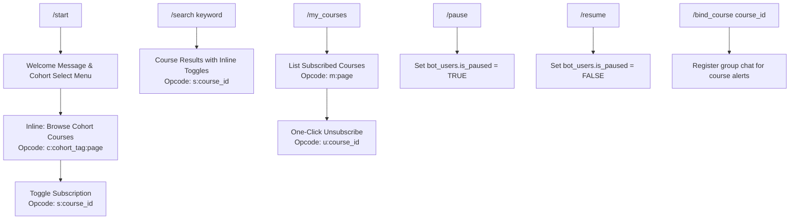

# Telegram Bot Specification: Moodle Radar

**Document Reference:** `specs/04-telegram-bot-spec.md`  
**Related Documents:** 
- [`intent/PRD.md`](file:///f:/SHADI/2-Programming/Model%20Notifications/moodle-radar/intent/PRD.md)
- [`specs/01-database-spec.md`](file:///f:/SHADI/2-Programming/Model%20Notifications/moodle-radar/specs/01-database-spec.md)
- [`specs/02-moodle-integration-spec.md`](file:///f:/SHADI/2-Programming/Model%20Notifications/moodle-radar/specs/02-moodle-integration-spec.md)
- [`specs/03-edge-functions-spec.md`](file:///f:/SHADI/2-Programming/Model%20Notifications/moodle-radar/specs/03-edge-functions-spec.md)
- [`specs/05-dashboard-frontend-spec.md`](file:///f:/SHADI/2-Programming/Model%20Notifications/moodle-radar/specs/05-dashboard-frontend-spec.md)

---

## 1. Overview & Architecture

The Telegram Bot serves as the primary notification interface for students. It requires **zero student credentials** and operates entirely via interactive Inline Keyboards and standard commands.

### Operational Principles
- **Gateway Runtime:** Serverless webhook hosted at Supabase Edge Function `/telegram-webhook`.
- **Secret Verification:** Incoming requests verified via header `X-Telegram-Bot-Api-Secret-Token`.
- **Parsing Mode:** `HTML` mode for all formatted messages.
- **Payload Constraint:** All inline keyboard `callback_data` payloads are strictly restricted to **< 20 bytes** (well within Telegram's 64-byte limit).

---

## 2. Command Architecture & Navigation Tree



### Supported Commands
| Command | Parameter | Description |
| :--- | :--- | :--- |
| `/start` | None | Registers or updates student in `bot_users`, displays cohort selection menu. |
| `/search` | `<keyword>` | Searches monitored courses matching keyword; returns inline keyboard with toggle buttons. |
| `/my_courses`| None | Lists all active subscriptions with one-click unsubscribe buttons. |
| `/pause` | None | Temporarily mutes alerts (e.g. during exam breaks) without clearing subscriptions. |
| `/resume` | None | Resumes alert delivery. |
| `/bind_course`| `<course_id>` | Admin/Group command: binds a Telegram group or channel to a course. |

---

## 3. Compact Callback Data Schema (< 20 Bytes)

To prevent payload overflow and conserve network egress, callback data uses a compact delimiter format:
`syntax: <opcode>:<target_id>:<context_param>`

| Opcode | Meaning | Example Payload | Encoded Size | Action Triggered |
| :---: | :--- | :--- | :---: | :--- |
| `s` | Toggle Subscribe | `s:1042` | 6 bytes | Toggles user subscription between Subscribed / Unsubscribed. |
| `u` | Unsubscribe | `u:1042` | 6 bytes | Directly removes course subscription from `/my_courses` view. |
| `c` | Cohort Catalog | `c:cyb3:1` | 8 bytes | Displays courses under cohort `cyb3`, page 1. |
| `m` | Manage Courses | `m:1` | 3 bytes | Displays active student subscriptions, page 1. |

---

## 4. Throttled Dispatch Engine (Rate-Limit Enforcement)

Telegram imposes strict broadcast rate limits:
- **Maximum Global Broadcast Rate:** 30 messages/second.
- **Single Chat Rate Limit:** 1 message/second.

### 4.1 Chunked Queue Dispatch Algorithm
When an announcement is triggered for a course with $N$ subscribers:
1. Divide subscriber list into chunks of **25 recipients**.
2. Dispatch each chunk concurrently using `Promise.allSettled`.
3. Enforce an explicit **1000ms pause** before sending the next chunk.

```typescript
// Chunked throttled dispatch implementation
async function dispatchBatchedMessages(
  botToken: string,
  recipientIds: number[],
  htmlMessage: string,
  replyMarkup: object
) {
  const CHUNK_SIZE = 25;
  const BATCH_PAUSE_MS = 1000;

  for (let i = 0; i < recipientIds.length; i += CHUNK_SIZE) {
    const chunk = recipientIds.slice(i, i + CHUNK_SIZE);
    
    await Promise.allSettled(
      chunk.map(async (chatId) => {
        return sendTelegramMessageWithRetry(botToken, chatId, htmlMessage, replyMarkup);
      })
    );

    if (i + CHUNK_SIZE < recipientIds.length) {
      await new Promise((resolve) => setTimeout(resolve, BATCH_PAUSE_MS));
    }
  }
}
```

### 4.2 HTTP 429 Retry-After Interceptor
If Telegram returns an HTTP 429 response during a burst, the sender intercepts the `retry_after` parameter:

```typescript
async function sendTelegramMessageWithRetry(
  botToken: string,
  chatId: number,
  html: string,
  markup: object,
  attempt = 1
): Promise<Response> {
  const url = `https://api.telegram.org/bot${botToken}/sendMessage`;
  const res = await fetch(url, {
    method: "POST",
    headers: { "Content-Type": "application/json" },
    body: JSON.stringify({
      chat_id: chatId,
      text: html,
      parse_mode: "HTML",
      disable_web_page_preview: true,
      reply_markup: markup
    })
  });

  if (res.status === 429 && attempt <= 3) {
    const data = await res.json();
    const retrySec = data.parameters?.retry_after || 2;
    // Sleep for retry_after plus 500ms safety buffer
    await new Promise((r) => setTimeout(r, (retrySec * 1000) + 500));
    return sendTelegramMessageWithRetry(botToken, chatId, html, markup, attempt + 1);
  }

  // Auto-prune blocked bot users on 403 Forbidden
  if (res.status === 403) {
    // Flag or delete user subscription
  }

  return res;
}
```

---

## 5. Message HTML Layout Templates

### 5.1 New Announcement (`mod_forum`)
```html
🚨 <b>{course_fullname}</b>
📢 <b>New Announcement:</b> {discussion_name}
👨‍🏫 <i>{author_fullname} • {formatted_time}</i>

{preview_snippet}

<a href="{moodle_discussion_url}">🔗 Open in Moodle</a>
```
**Inline Keyboard:**
`[ 🔗 Open in Moodle ]` (url) | `[ ⚙️ Subscriptions ]` (callback: `m:1`)

---

### 5.2 Assignment Created or Deadline Modified (`mod_assign`)
```html
⚠️ <b>{course_fullname}</b>
📝 <b>Assignment Alert:</b> {assignment_name}
📅 <b>Due Date:</b> <b>{due_date_formatted}</b>

Status: <i>{status_badge}</i> (New / Deadline Revised)

<a href="{moodle_assignment_url}">🔗 View Assignment</a>
```
**Inline Keyboard:**
`[ 🔗 View Assignment ]` (url) | `[ ⚙️ Subscriptions ]` (callback: `m:1`)

---

### 5.3 New Course Material or Link (`mod_resource`, `mod_url`)
```html
📁 <b>{course_fullname}</b>
📄 <b>New Resource Uploaded:</b> {resource_name}
⏱️ <i>Added on {formatted_time}</i>

<a href="{moodle_resource_url}">🔗 Download / Open Link</a>
```
**Inline Keyboard:**
`[ 🔗 Open in Moodle ]` (url) | `[ ⚙️ Subscriptions ]` (callback: `m:1`)
